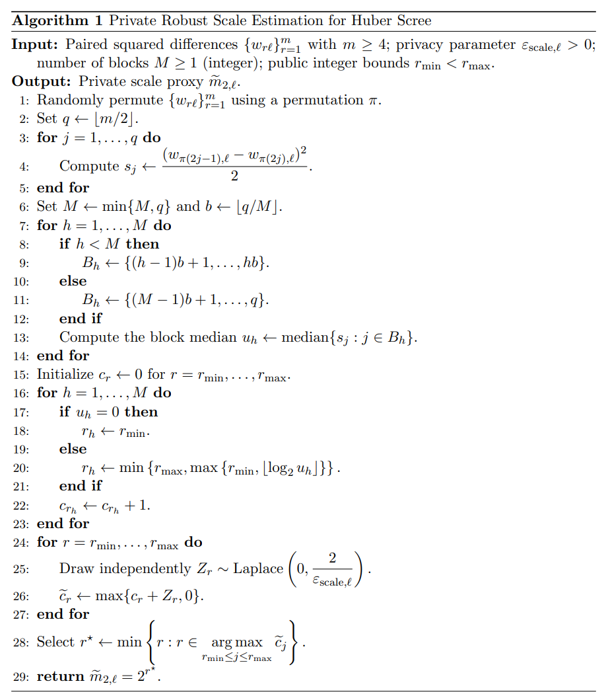
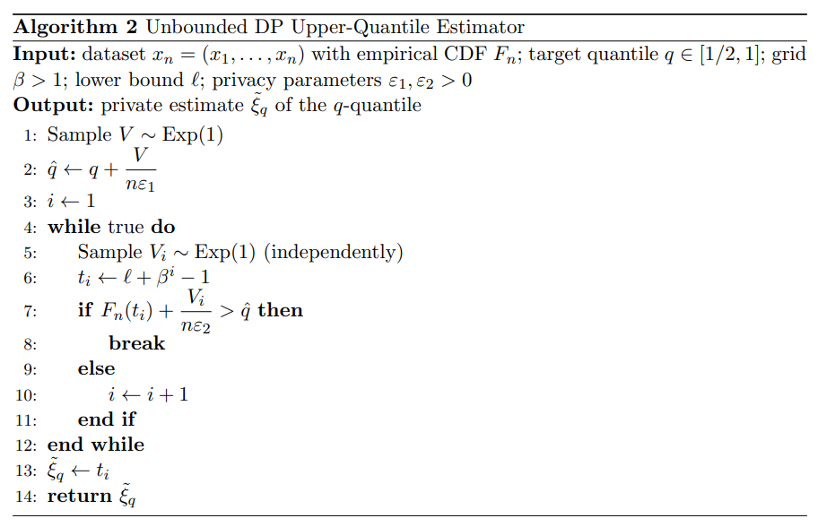
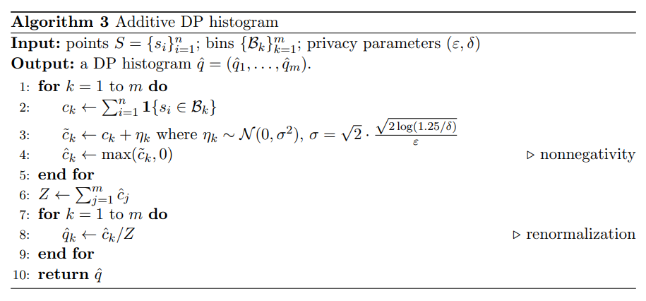
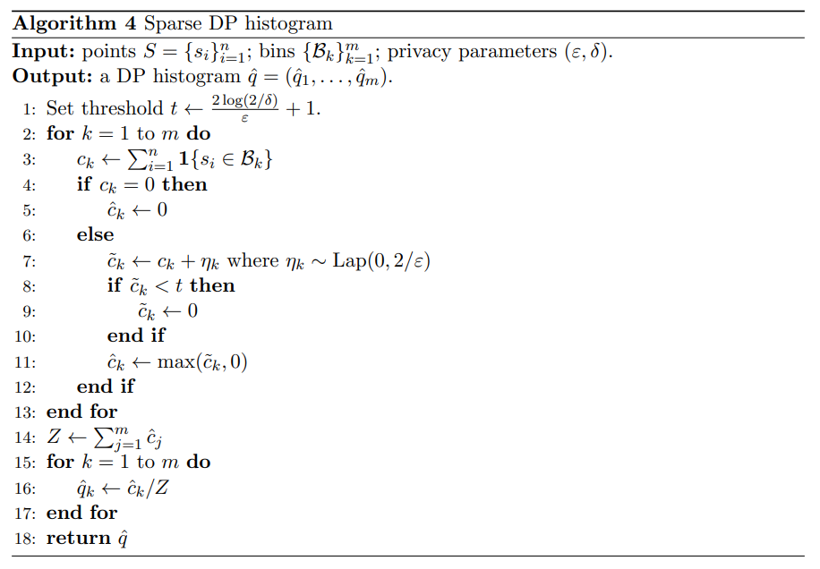
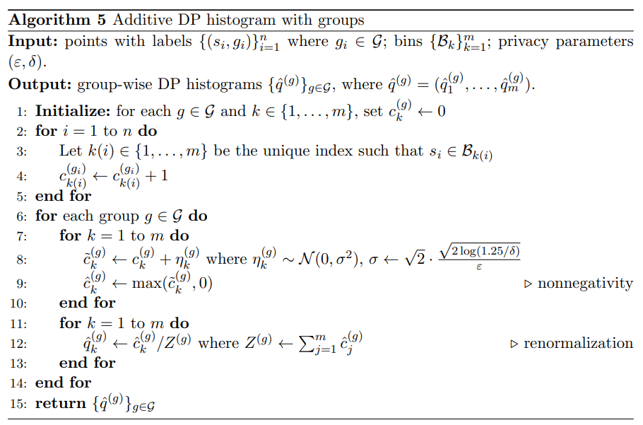
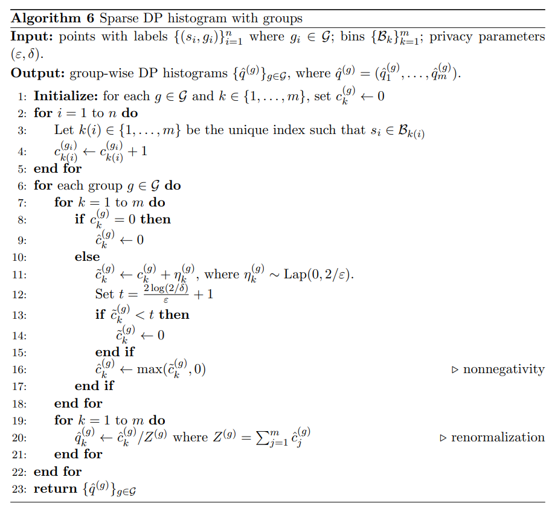

```{r, include = FALSE}
knitr::opts_chunk$set(
  collapse = TRUE,
  comment = "#>"
)
```

This page collects the algorithms used in the `dppca` package. 


## Algorithm 1: Private and robust estimator for \(m_2\) {#alg-m2}

This algorithm constructs a private scale proxy $\widetilde m_{2,\ell}$ for selecting the Huber robustification parameter $\tau_\ell$. Given the paired squared differences $\{w_{r\ell}\}_{r=1}^{m}$, it forms additional pairwise half squared differences and computes block medians to obtain a robust measure of variability. A private histogram over dyadic scales is then used to select the final scale proxy.

{width=95%}

## Algorithm 2: Unbounded DP upper-quantile estimator {#alg-unbounded-quantile}

This one-sided algorithm is the building block for the score-frame and PMWM
quantile estimates. Following [Durfee (2023)](#ref-Durfee2023), it searches a
geometric grid using noisy comparisons against the empirical CDF. The fully
unbounded mechanism invokes the one-sided search in both the positive and
sign-flipped directions.

For a one-sided quantile release with total budget $\varepsilon_Q$, the implementation uses $\varepsilon_1=\varepsilon_2=\varepsilon_Q/2$ for the noisy target and query counts. It accepts $0<q<1$ and requires a public lower bound $\ell\le\min_i x_i$. Its empirical CDF queries count observations strictly below the candidate: $F_n^{<}(t)=n^{-1}\sum_i\mathbf1\{x_i<t\}$.

{width=95%}

The displayed pseudocode shows an unbounded search. The implementation limits the search to 5,000 grid queries by default; if no noisy count reaches the noisy target, it issues a warning and returns the last grid value. PMWM uses this default limit with $\beta=1.001$, whereas score-frame estimation uses $\beta=1.01$. The fully unbounded wrapper excludes capped results when selecting a signed quantile. The resulting search limits are described in [PMWM Methodology](method-dp-scree.html#pmwm) and [DP Score Methodology](method-dp-score.html#private-frame).

## Algorithm 3: Additive DP histogram {#alg-add-hist}

The additive DP histogram adds independent Gaussian noise to each bin count and
then post-processes the noisy counts to make them nonnegative and normalized.
This is the basic DP histogram mechanism used for score histogram visualization.

{width=95%}

## Algorithm 4: Sparse DP histogram {#alg-sparse-hist}

When the grid is fine, many bins may be empty, and additive noise can dominate
the visualization. The sparse histogram keeps only stable bins whose noisy
counts are above a threshold, following the count-based sparse histogram idea of
[Karwa and Vadhan (2018)](#ref-Karwa2018).

{width=95%}

## Algorithm 5: Group-wise additive DP histogram {#alg-group-add-hist}

The group-wise additive histogram applies the additive DP histogram procedure
separately to each group, using a common frame and grid. It is useful for
comparing PCA score distributions across groups.

{width=95%}

## Algorithm 6: Group-wise sparse DP histogram {#alg-group-sparse-hist}

The group-wise sparse histogram applies sparse thresholding separately within
each group and bin. It provides a private group-wise score histogram while
suppressing bins that are not reliably distinguishable from zero.

{width=95%}

The histogram pseudocode shows normalization when the retained mass is positive. In the implementation, zero total mass causes the additive methods (Algorithms 3 and 5) to stop with an error, while the sparse methods (Algorithms 4 and 6) return an all-zero histogram. Group-wise privacy accounting assumes public, fixed group memberships, as explained in [DP Score Methodology](method-dp-score.html#grouped-score).

## References

<span id="ref-Durfee2023"></span>
Durfee, D. (2023). Unbounded differentially private quantile and maximum
estimation. In *Advances in Neural Information Processing Systems*, 36,
77691--77712.

<span id="ref-Karwa2017"></span>
Vishesh Karwa and Salil Vadhan. (2018). "Finite sample differentially private confidence intervals". In <em>Proceedings of ITCS 2018</em>, LIPIcs, 94, 44:1--44:9. https://doi.org/10.4230/LIPIcs.ITCS.2018.44

<span id="ref-Wasserman2010"></span>
Wasserman, L. and Zhou, S. (2010). A statistical framework for differential
privacy. *Journal of the American Statistical Association*, 105(489), 375--389.
https://doi.org/10.1198/jasa.2009.tm08651

<span id="ref-Yu2024"></span>
Yu, M., Ren, Z., and Zhou, W.-X. (2024). Gaussian differentially private robust
mean estimation and inference. *Bernoulli*, 30(4), 3059--3088.
https://doi.org/10.3150/23-BEJ1706
